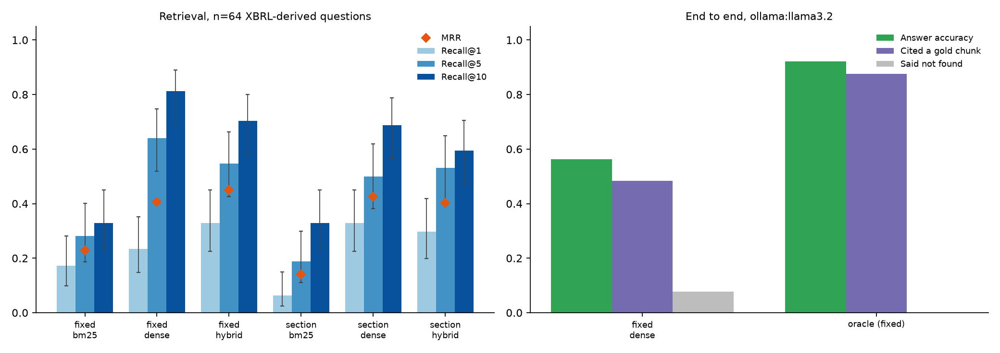

# footnote: SEC filings Q&A with citations, measured

[](https://github.com/CH4RL3I/footnote/actions/workflows/ci.yml)  

Question answering over SEC 10-K filings with page-level citations, and a harness that measures how often it is actually right.

The chatbot is the small part. The point is the evaluation: numeric questions built from XBRL, retrieval baselines, signed/unit-aware answer scoring, and an optional reviewed-evidence path with source quotes.



## Results

**Fresh source-grounded development run (2026-10-31):** 38/64 retrieved and 63/64
oracle numeric answers correct on the same real-file corpus; 16/20 and 20/20 on the
selected agent-reviewed subset. This is a hybrid source-extraction/model-fallback pipeline,
not pure-model accuracy or a held-out result. [Methods, failures, source quotes and actual
model-call counts](docs/evaluation-2026-10-31/README.md).

**Historical baseline, not a result of the current scorer.** The figures and committed
`docs/results.*` below used the previous magnitude-only scorer (which also guessed bare
numbers as millions or dollars) and same-company/number heuristic citation labels. They
remain unchanged for reproducibility. New evaluations identify `signed-usd-v2` and their
evidence mode explicitly; rerun before making comparisons. The historical v4 development run is documented in
[the 2026-10-29 evaluation](docs/evaluation-2026-10-29/README.md). It reuses this corpus and
adds agent-reviewed source labels; it is not a human-audited or held-out benchmark.

Corpus: the two latest 10-Ks for AAPL, MSFT, NVDA, JPM and KO (10 filings, about 4,700 chunks). Questions: 64, generated from XBRL facts (no human labelling). Full tables and per-question data are in [docs/results.md](docs/results.md) and [docs/results.json](docs/results.json).

**Retrieval.** Recall@k is the share of questions where at least one gold chunk is in the top k. No LLM involved, so it is deterministic.

| Chunking | Retriever | Recall@1 | Recall@5 | Recall@10 | Recall@20 | MRR |
|---|---|---|---|---|---|---|
| fixed | bm25 | 17% | 28% | 33% | 41% | 0.229 |
| fixed | dense | 23% | 64% | 81% | 86% | 0.406 |
| fixed | hybrid | 33% | 55% | 70% | 84% | 0.449 |
| section | bm25 | 6% | 19% | 33% | 45% | 0.141 |
| section | dense | 33% | 50% | 69% | 84% | 0.426 |
| section | hybrid | 30% | 53% | 59% | 72% | 0.403 |

With n=64 the 95% Wilson intervals are wide (Recall@5 for fixed + dense is 64%, 52% to 75%). Many of the differences between the middle rows are within noise.

**End to end** (llama3.2 3B via Ollama, top 6 chunks). "Oracle" hands the generator the gold chunks directly, which separates retrieval failures from reading failures.

| Configuration | Answer accuracy (95% CI) | Correct and cited a gold chunk | Cited any gold chunk | Said "not found" |
|---|---|---|---|---|
| fixed + dense | 56% (44% to 68%) | 44% | 48% | 8% |
| oracle (gold chunks given) | 92% (83% to 97%) | 81% | 88% | 0% |

I ran end to end for one configuration only: fixed + dense, chosen for the best Recall@5, which is closest to the 6 chunks the generator sees. Hybrid has the best MRR (0.449) but was not run end to end.

### What the numbers say

- **Naive beat clever.** Fixed windows with dense retrieval had the best recall at 5 and 10. Section-aware chunking did not help, and section + hybrid was worse than section + dense at k=10. I expected the opposite. A plausible reason, not tested: a numeric answer sits in a financial-statement row, and splitting on structure does not make that row any easier to match against a question.
- **BM25 alone is poor** (Recall@5 of 19% to 28%). A question such as "Apple's net income" shares most of its words with the same row in every company's filing, and only the company name and year differ.
- **Retrieval is the bottleneck, not the model.** Given the right chunks, llama3.2 answers 92% of questions. Given retrieved chunks it answers 56%. The gap comes from the retriever surfacing the wrong company, year or line item. Typical wrong answers are a plausible figure from the wrong year (Apple FY2024 total assets answered with $352,583 million, which is the FY2023 figure).
- **Citations are the weakest part.** Even with the gold chunks, the model cited a gold chunk on 88% of questions; with retrieved chunks, 48%. 5 of its 36 correct answers cited nothing, and some cited malformed ids (for example `[JPM-FY2024#177556]`), which are counted as not cited.
- **Retrieval is uneven by metric.** For fixed + dense, Recall@10 was 6/6 for R&D and 8/8 for operating income, but only 5/10 for total assets (the balance-sheet chunk is easy to confuse with the many other tables that carry assets).

## How the gold set is built

Every 10-K carries machine-readable XBRL facts. The SEC publishes them per company at `data.sec.gov/api/xbrl/companyfacts/CIK##########.json`. That is a free source of exact answers:

1. For each filing, pick the fact for the filing's own fiscal period (revenue, net income, total assets, R&D expense, operating cash flow, operating income, stockholders' equity). Facts are matched on the accession number and period end. The `fy` field in companyfacts is the filing's fiscal year, not the period's, and comparatives from later filings are repeated, so matching on `fy` gives wrong answers.
2. Generate the question ("What was Microsoft's net income for fiscal year 2025?"), keeping the raw value (`101832000000`).
3. Find heuristic candidate chunks (called "gold" in historical outputs). XBRL says `391035000000`, the filing says `391,035` under an "(In millions)" caption, and the MD&A says "$391.0 billion". `numfmt.filing_forms` renders the value in each form a filing would print, and a boundary-aware regex searches the chunks (so `391,035` does not match inside `1,391,035`). These are same-company number matches, not checks of the requested metric/year. Candidates are built separately for each chunking strategy; the historical run kept questions with a candidate under every strategy (all 64 of 64 qualified).
4. Score answers by numeric match: "$391,035 million", "$391.0 billion" and
   "391035000000" all match 391035000000 within 0.1% relative tolerance. This rejects a
   transposed-digit near miss (13,137 for 13,107). The current scorer preserves explicit
   signs and units. Bare numbers retain their actual magnitude, never implicit millions.
   Bare years, canonical citation IDs and percentages are excluded.

The answer parser uses whole lexical tokens. Each numeric lexeme is visited once with
its complete neighboring sign/currency prefix; rejecting `€- 45 million` or `C$ 45 million`
never retries at the inner `45`. Its finite supported grammar is ASCII numbers with optional
explicit scales, `$`, spaced `USD`/dollar markers, ASCII `+`/`-` or Unicode minus `−`
attached to `$` or digits, and marked accounting notation. Parenthesized values need a
currency, scale or grouped-digit marker: bare `(5)` may be a note, while `($45)`,
`(45 million)` and `(5,000)` are supported negatives. Any sign followed by whitespace is
rejected as ambiguous, including line-start Markdown bullets and label separators such as
`FY2024 - $45 million`; it is neither positive nor a loss. Attached `-$45`, `$-45`, `-45`,
`−$45`, `USD -45`, `$ -45` and `-$ 45` remain supported.

Unicode markers are checked by character class on encountered characters, without an
import-time scan: all `Pd` dashes and characters whose names contain MINUS/HYPHEN/PLUS/DASH
are sign-like, but only canonical `+`, `-`, `−` are accepted. All `Sc` currency symbols
other than ASCII `$` are rejected, including fullwidth/small dollars. Attached control or
combining marks (Unicode categories C/M), noncanonical parentheses and numeric grouping
separators are rejected rather than silently dropping a sign or falling back to a smaller
magnitude. NFKC is used only to identify noncanonical marker/code layouts for rejection,
not to convert them to supported USD. Ordinary punctuation such as `**-$45 million**` and
`:$45 million` remains supported. A preceding punctuation/whitespace run is checked for
hidden monetary markers: `-**$45 million**`, a backslash between `-` and `$`, and
`(**$45 million**)` are conservatively rejected. Formatting is not decoded or normalized;
a wrapper may delimit an intact canonical prefix, but must not hide an earlier sign,
currency or accounting marker. Known currency words/decorated known codes (including edge underscores used as emphasis)
are checked before this scan stops at ordinary prose, so `EUR **$45 million` and
`_EUR_ 45 million` are rejected. Intact plain US/USD/dollar words continue the scan instead
of immediately rejecting: `Revenue in the US: $45 million` and `**USD -45 million**` remain
valid, while an earlier hidden minus in `-USD **$45 million` still rejects the amount. This is a character-class policy, not universal
confusable interpretation or currency conversion. Letter currency labels are a finite set:
`EUR GBP JPY CNY CHF CAD AUD RMB`, euros/pounds/yen. Contiguous code-prefixed dollar forms
such as `US$`, `C$`, `HK$`, and signs before `USD`/`US` codes, are unsupported and fail closed.
Touching formatting cannot break this attached-token boundary: `C\$45 million`,
`HK**$45 million**` and a suffix such as `45 million C\$` remain unsupported composite
codes. A lone leading backslash before an otherwise intact USD amount remains a benign
delimiter; ordinary prose separated by whitespace is not treated as an attached code.

Hyphenated scale compounds such as `$45-million` are rejected without raw-dollar fallback.
The same finite rejection applies when declared formatting obscures the sign/scale boundary
(`$45\-million`, `**$45**-million`, `$45-**million**`, `$45 *-* million`, `$45-_million_`)
and for `+`/`−` variants or existing scale aliases. It does not interpret a following number
or `$` amount as a unit; percentage annotations, independent amounts and range checks retain
their existing behavior.
Both endpoints connected only by a dash/minus and currency markers (`$40 - $45 million`)
are excluded as ambiguous ranges/arithmetic. A percentage/basis-point annotation such as
`$45 million (-5%)` is not a USD range endpoint and preserves the first amount. For adjacency checks only, the formatting characters `*`, `_`, backtick, `~` and backslash
are ignored in the gap: bold wrappers cannot hide a restatement or binary range. Amount
syntax itself is not decoded or normalized. Closing wrappers are also looked across to
reject a hidden known currency label or scale (`**45 million** euros`, `$45 **million**`),
without crossing semicolon/comma/parenthesis/sign boundaries. The existing trailing
currency/sign-chain check also skips closing formatting, so `**45 million** - EUR` and
`**45 million** - C\$` cannot be credited as USD. Existing `%`, percent/percentage,
bps/basis markers and unsupported hundred/quadrillion scales remain rejected behind
wrappers, with percentage metadata preserving a preceding valid USD annotation.
Wrapped scale aliases are rejected without raw-value fallback; direct `bns`, `tns` and
`mms` retain the same billion/trillion/million scaling already accepted by the parser.
A directly
following parenthesized value (`$1.2 billion ($1,200 million)`) is an ambiguous restatement;
its second value is excluded rather than treated as a loss. Separate independent accounting
amounts with `;` or `and` to retain their signs. Separate other independent amounts with
`;`, `,` or `and`; `non-US $45 million` remains ordinary prose. Contradictory labels such as
`non-USD $45 million` (including signed/accounting variants) are conservatively rejected.

Canonical bracketed citation groups are removed before checking adjacent restatements,
including `[AAPL-FY2024#0123]` and comma/semicolon-separated ID groups. Shared citation syntax
uses the complete identifier: chunk suffixes have at least four digits (`:04d` is minimum
width), and a longer/malformed ID cannot credit a shorter allowed prefix. Answer citations
still require exact membership in the supplied context. Ordinary brackets/prose are not
normalized as citation groups.

Any HTML-like tag or entity causes the whole message to be rejected before lexing. Tags
and entities are never decoded into monetary syntax. Numeric references are recognized
with or without a terminating semicolon (`&#8722`, `&#x2212`); named references still
require their semicolon, so bare `AT&T: $45 million` remains valid.
This is not financial entailment, universal prose parsing or arithmetic interpretation.
Numbered lists (`1) $45 million`), prose parentheses (`Net income (loss) $(45) million` /
`(FY2024: $45 million)`), `US dollars` suffixes and parenthesized citations after a currency
suffix are outside the grammar. Prefer one plain amount with attached sign and unit plus
its citation, without bullets, label separators or parenthesized restatements. A message
outside the contract may still contain other independently parsed quantities; numeric
matching can match any of those and does not establish source support.


The candidate locator is deliberately lenient: any of the company's ingested filings counts, because the FY2025 figure legitimately appears as a comparative in the FY2026 10-K. So a chunk from the neighbouring year can be a gold chunk.

Per-question data is in [docs/goldset.json](docs/goldset.json).

### Reviewed evidence and versioned scoring

For an evaluation with reviewed citation labels, supply a UTF-8 JSON manifest. This
**illustrative synthetic** entry labels an invented ACME question, not a real SEC filing:

```json
{
  "version": 1,
  "description": "SYNTHETIC example; replace with your reviewed corpus labels",
  "questions": [{
    "id": "ACME-FY2024:net_income",
    "ticker": "ACME",
    "fiscal_year": 2024,
    "metric": "net_income",
    "value": -45000000000,
    "unit": "USD",
    "evidence": {
      "section": [{
        "chunk_id": "ACME-FY2025#0001",
        "quote": "Fiscal year | 2024 | 2023\nNet income (USD millions) | (45,000) | 10"
      }]
    }
  }]
}
```

Use known question IDs and exact metadata from your generated question set, then inspect
the actual source to label the metric, fiscal period, sign and unit. Each quoted string
must occur verbatim in its chunk's body. A reviewer may label a clearly identified
comparative period in a newer filing. The loader checks question metadata, signed USD
value, duplicate/unknown labels, company identity and quote grounding. **The annotation
author asserts semantic support**; source substring validation is not an entailment proof.

The manifest must cover exactly the chunking strategies used by the run, including the
end-to-end configuration if different. This makes every supplied annotation checkable;
for a `--chunking all` run provide both `fixed` and `section` entries per question.
Every selected question needs at least one reviewed quote under every active strategy.
Only annotated questions are evaluated. Unannotated questions are excluded and counted;
missing or invalid annotations fail before model calls/output writes, with no fallback to
number-matched candidates.

```bash
# Replace reviewed.json with real, independently reviewed labels for your local corpus.
# A separate output directory preserves the historical baseline artifacts.
uv run filingqa eval --chunking section --retriever bm25 \
  --e2e --e2e-config section+bm25 --reviewed-evidence reviewed.json \
  --output-dir runs/reviewed-v2
```

Without `--reviewed-evidence`, the original exploratory candidate-selection path remains
available and is labeled `candidate` / `company-number-candidates-v1`. Reviewed runs use
`reviewed` / `reviewed-quotes-v1`. Both use `signed-usd-v2`. JSON outputs include versions,
mode, generated/annotated/selected/excluded question counts and, for reviewed runs, the
manifest SHA-256. Legacy JSON field names such as `cited_gold` are retained, but their
labels come from the declared evidence mode; report tables/charts identify that mode.
Do not compare modes or versions as if they measured the same evidence standard.

The fixture `tests/fixtures/reviewed_evidence_synthetic.json` exercises this path offline.
It is not new financial accuracy evidence or a held-out company/year benchmark. Build a
separately reviewed, untouched benchmark before tuning retrieval against a claimed test set.

### Source-grounded numeric answers

`source-grounded-usd-v11` parses recognized single-company, single-year numeric questions
from the question text. It filters the top-100 retrieval pool by company, keeps six seed
chunks and includes immediate same-filing/Item neighbours to recover headings and complete facts. Neighbours may supply values as well as units/year headings.
Comparative columns in newer filings remain eligible: the year comes from the explicit
source column, never from the filing year alone.

For supported annual tables and explicit "respectively" prose, the answerer connects the
metric, requested year, USD scale and accounting sign, then renders a single signed USD
amount with source IDs. Its runtime reads only the question and source context, not XBRL
answers, evaluation labels or reviewed manifests. The returned answer preserves ordered verbatim source quotes. Closed question forms exclude product/segment, adjusted, changes and NCI requests from extraction. Used-in-only cash-flow labels express negative outflows. Conflicting complete facts or absence of the requested body year cause abstention; year checks use numeric boundaries. Unsupported layouts retain
an explicitly **unverified model fallback**; qualitative questions retain normal generation.

This is a finite extraction contract, not a general financial entailment engine. Supported
layouts require explicit years/scale and company-level metric scope. Segment, adjusted,
quarterly and foreign-currency figures are excluded from verified annual-USD extraction.

R&D tables require a closed income/results or standalone operating-expenses title. Only
recognized monetary captions, annual-period labels and year-header metadata may follow
that title before the year columns; other declarations or component-breakdown labels
reject extraction. Note headings and parent-only economic disclosures veto weak
operating-expenses or bare-statement scope. Bare primary-statement titles also require an
actual Item 8 body heading, a complete PART II / Item 8 / statement-title sequence, or an
exact local requested-company/registrant line. A chunk's stored Item 8 label alone does
not establish company scope.

The weak standalone operating-expenses route also checks the entire preceding proven
source block. An intervening table cannot erase an earlier ambiguous component
declaration and turn a later R&D component row into a company total. Unsupported scope
remains an unverified fallback; this conservative check does not add new source coverage.

The 37 initial independent source contracts, 42 reviewer/host cases, 245 additional
currency, scope, sign and conflict contracts, and 488 further review regression/control
cases include synthetic sources and adapted real statement layouts. These are development
tests, not held-out accuracy evidence; the existing scorer's strict tests remain in place.

Recognized monetary captions use closed USD clauses; unknown dollar-name/symbol suffixes cannot
supply a USD scale. Anchored selected consolidated tables remain eligible, while prose
references and segment/parent qualifications do not establish company-wide scope.
Governing entity headings also constrain narrative and respectively extraction. A new
table cannot borrow an earlier table's caption or title, and prose or non-year column
headers end year-column alignment. Closed financial section and cash-flow leads remain
supported. Specific segment scope survives intervening rows and generic sales rollups.
Year-bearing cells require recognized annual year/date forms; quarter, half-year and
subannual month/week periods are excluded, while annual 52/53-week periods remain eligible.
Only short footnote markers are stripped from metric labels; semantic qualifiers such
as adjusted, managed and average are retained and excluded from company-wide extraction.
Noncontrolling-interest qualifications are checked below as well as above net income;
closed requested-company shareholder/parent rows identify the parent-attributable amount.
Registrant lines and table titles share the same legal-name grammar. Explicit recognized
Item transitions inside legacy chunks start independent blocks; repeated headings and
bare cross-references do not clear qualifications. Internal source gaps use out-of-band
markers, so literal source text cannot reset entity or period scope. Cash-flow labels use
the same footnote/colon normalization when applying the governing used/provided lead.

New chunks carry line-boundary provenance; legacy fixed windows are joined only through exact aligned 220/40-word overlap. Uncertain exterior fragments are excluded. Caller-constructed complete chunks assert that their bodies are complete; legacy index loading does not assume this. The CLI labels source-derived answers and unverified model fallbacks. Model prompts are capped at six chunks.

Evaluation JSON records `answering_version`, per-answer `answer_method`, `source_evidence`
and `grounding_note`. Each end-to-end row gives method counts and **actual model calls**.
A source-extracted answer does not call the LLM and is not credited as model generation.
Its citations and quotes cover the entire supplied neighbouring context group, rather
than a minimal set of supporting chunks. Any-label citation hits can follow directly
from oracle seeds being included in that group. JSON and Markdown report citation
counts/rates separately for source-extracted and model answers; these label-hit metrics
are not citation precision.

Material disagreement between complete table and narrative facts causes abstention;
rounded prose may differ by at most half its stated monetary unit. Explicit parent-
attributable table rows take precedence over generic consolidated totals with a different
entity scope, and the returned grounding note discloses that precedence. Disconnected
source blocks cannot share scope, currency, year or unit headings.
The changed context/answer policy and development reuse mean these new pipeline figures
must not be presented as a controlled improvement in the underlying model.

**Focused fix-cycle proof:** 1,986 offline tests passed, 3 deselected; Ruff and diff checks passed. Cumulative focused validation includes 75 source-scope contracts and 5 candidate-selection tests; the final cycle adds 4 split-subtable controls. 6 earlier host-generated positive inputs gained explicit GLOBEX company anchors while their $800 million, $83 million and $91 million expectations stayed fixed. The original 37 + 42 JSON fixtures remain byte-identical.

### Qualitative questions (not scored)

[docs/qualitative.md](docs/qualitative.md) has ten hand-written questions (risk factors, segment commentary, cybersecurity governance) with the answers, citations and retrieved pages. They are **not scored**. There is no gold answer, so they only show behaviour. Reading them: some answers are grounded and readable (Microsoft cybersecurity governance, Coca-Cola health and wellness), some are shallow (NVIDIA export controls, one sentence and no citation), and one is off target (the Apple Services question retrieved a revenue-recognition note rather than segment commentary).

## Design

- `filingqa.edgar`: EDGAR client. Descriptive User-Agent from `SEC_USER_AGENT` (fails clearly if missing), at most about 6.5 requests per second, raw downloads cached in `data/raw/`.
- `filingqa.parse`: HTML to pages, table rows and Item sections. Pages are the filing's `page-break-after` breaks; citations show the printed page number where one is detected. Handles table-of-contents entries, running page headers, NVIDIA's statements under Item 15, and JPMorgan's annual-report layout (mapped from running headers to Items 7 and 8).
- `filingqa.chunking`: `fixed` (220-word windows, 40 overlap) and `section` (whole lines packed up to 220 words, never crossing an Item). Both prepend a company / form / fiscal-year header to the indexed text.
- `filingqa.retrieval`: BM25 (`rank_bm25`), dense (Ollama `nomic-embed-text`, vectors in numpy, embedding cache in SQLite) and hybrid via reciprocal rank fusion (k=60).
- `filingqa.generate`, `filingqa.answer`: Ollama `llama3.2` by default, Anthropic `claude-haiku-4-5-20251001` optional. The prompt restricts answers to the excerpts, requires chunk-id citations, and prescribes the reply "not found in the filings".
- `filingqa.grounding`: finite source-derived annual USD facts, period/scale/sign checks and quote provenance.
- `filingqa.evidence`: reviewed quote manifests and strict validation.
- `filingqa.evaluate`: versioned candidate/reviewed evaluation harness.

## Quickstart

```bash
uv sync --extra anthropic --group dev    # drop --extra anthropic if you only use Ollama
export SEC_USER_AGENT="your-project you@example.com"   # required by SEC, use your own contact
ollama pull nomic-embed-text && ollama pull llama3.2

uv run filingqa ingest                                  # AAPL MSFT NVDA JPM KO, latest 2 years
uv run filingqa index --chunking all --retriever all    # about 9 minutes for embeddings
uv run filingqa ask "What was NVIDIA's R&D expense for fiscal year 2025?" \
    --chunking fixed --retriever dense
uv run filingqa eval --e2e --e2e-config fixed+dense \
    --output-dir data/runs/source-grounded             # preserves historical docs/results.*
```

`filingqa eval` without `--e2e` runs the retrieval metrics only (under a minute).
CLI and programmatic evaluations default to a fresh timestamped directory under
`data/runs/`, preserving the committed historical reports. Use `--output-dir` to choose
an explicit destination. For Anthropic, set `ANTHROPIC_API_KEY` and pass `--backend anthropic`.

Tests run offline in a few seconds: `uv run pytest`. Tests that need the network or Ollama are marked `network` / `ollama` and skipped by default (`uv run pytest -m "network or ollama"`). CI runs ruff and the offline tests.

Reference run on an Apple-silicon laptop that was also heavily loaded: ingest and parse under a minute, embedding both chunkings about 8.5 minutes, retrieval eval 25 seconds, end to end (128 generations plus 10 qualitative) about 16 minutes.

## Limitations

- The gold questions are numeric only, and are all "find this one figure" questions. They say nothing about how well the system handles narrative questions.
- n=64, from 5 companies. Confidence intervals are wide; treat differences of under about 15 points as unproven.
- Tables are hard. Rows are flattened to text, so a chunk that starts mid-table loses its column headers and units, and the model can pick the wrong year's column.
- llama3.2 (3B) is small. It picks wrong-year figures, sometimes drops or malforms citation ids, and gives thin answers to qualitative questions. Results with a larger model will differ, and I did not run the Anthropic backend.
- End to end was measured for one retrieval configuration.
- Raw retrieval metrics use the original retrievers. Numeric answering filters a top-100 candidate pool by company and adds adjacent source/header chunks. It can still miss relevant evidence outside that pool. Filing-year filtering is deliberately avoided because newer comparative columns can support older periods.
- "Fiscal year" is the calendar year of the period end, which matches how these five companies label theirs.
- Page numbers are the printed folio when detected, otherwise the index of the page break, so they can be off by a page or two.
- Scoring accepts a correct number anywhere in the answer, so an answer that lists several figures could match by luck.
- The numeric tolerance was tightened from 0.5% to 0.1% after I saw a near-miss counted correct. I rescored the stored answers rather than rerunning the generator.

## License

MIT, Emilio Gappa, 2026.
